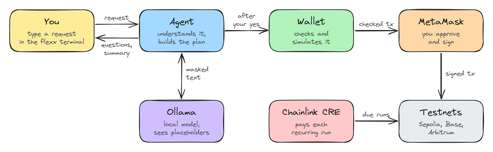

<h1 align="center">Flex</h1>

<p align="center">A private AI agent layer for your Ethereum wallet.</p>

<p align="center">
  <a href="#key-features">Features</a> &middot;
  <a href="#how-it-works">How it works</a> &middot;
  <a href="#quick-start">Quick start</a>
</p>

## Introduction

Flex lets you pay people by typing what you want, the way you'd say it:

```text
send 50 usdc to aradhya on base and 20 to mihir on arbitrum
```

A model running on your own machine works out who you mean, which chain your money is on, and whether it has to bridge first. Flex then shows you a plain summary. Nothing moves until you say yes, and MetaMask asks once more before anything is signed.

The catch with putting a language model near a wallet is that models can be wrong, and they can be talked into things. So in Flex the model never drives. Plain code runs a fixed pipeline, asks the model four narrow questions, and checks every answer before using it. The model never even sees your real addresses or amounts.

Everything sensitive stays on your device. The model runs through Ollama, and chain reads, ENS lookups and web fetches go out through Tor. Flex runs on Ethereum Sepolia, Base Sepolia and Arbitrum Sepolia with USDC and ETH.

## Key Features

- **Payments**: to addresses, saved contacts or ENS names, and to several people at once. Payments on the same chain go out as one atomic batch.
- **Cross-chain**: if your USDC is on the wrong chain, the plan gets a Chainlink CCIP bridge step with a capped fee.
- **Recurring payments**: say `pay mihir 10 usdc every friday for 8 weeks`. You approve one MetaMask permission, capped per run and expiring after the last one, and a Chainlink CRE workflow pays each run when it's due.
- **ENS groups**: say `send 10 usdc to everyone under iitr.eth` and pick who gets paid.
- **Wallet questions**: balances, recent transfers and transaction status, mostly answered from local data without calling the model.
- **Spending limits**: set in settings or with `/limits`. Nothing typed into the chat can change them.

## How It Works

1. You type a request into `flexx`.
2. The agent refreshes balances and blocks private keys or seed phrases.
3. The model pulls out amounts and recipients. Code verifies them and resolves names through your contacts and ENS.
4. Before the model pairs payments with recipients, real values are swapped for placeholders.
5. Code builds the plan (source chains, bridges, schedules) and checks it against your balances and limits.
6. You see a summary and answer `y` or `n`.
7. On `y`, the wallet decodes and simulates the transactions with `eth_simulateV1`, then MetaMask asks you to sign.

Anything Flex didn't get from you directly, such as pasted text, a web page or an ENS record, goes to a separate quarantined model with no tools. Values taken from it need your explicit confirmation and can never set up a recurring payment. Local data is stored in SQLCipher, with the key kept in your OS keychain.



## Repository Layout

```text
src/                 Agent pipeline and the flexx terminal client
wallet/              Execution layer: checks, simulates and sends through MetaMask
wallet/contracts/    IntentExecutorV4, which runs registered recurring plans
wallet/cre/          Chainlink CRE autopay workflow
packages/protocol/   @flex/protocol, the hand-off schema both sides validate
frontend/            Static install page
```

## Quick Start

### Prerequisites

- macOS or Linux with Git, Python 3 and a C/C++ toolchain
- Node 24, or 22.12+ on the 22.x line
- [Ollama](https://ollama.com) and Tor
- MetaMask, with testnet ETH and [test USDC](https://faucet.circle.com)
- RPC URLs for the three testnets, including endpoints that support `eth_simulateV1`

### Install

```bash
curl -fsSL https://raw.githubusercontent.com/0xr10t/Flex/master/install.sh | bash
```

This builds Flex into `~/.flex`. It doesn't use sudo, edit your shell profile or start anything.

### Configure and run

```bash
cd ~/.flex/current
cp .env.example .env      # your public wallet address and RPC URLs
npm run testnet:setup     # writes the agent, wallet and CRE configs
~/.flex/bin/flexx
```

`flexx` starts Tor, Ollama, the wallet and the agent for you. Type `/` for commands, and run `/doctor` if something isn't working.

### Recurring payments

Recurring payments also need Foundry, the CRE CLI (`cre login`), a funded test key in `CRE_ETH_PRIVATE_KEY`, and `FLEX_SOCKS_PROXY=direct`, because the local CRE runner can't use Tor.

```bash
forge build --root wallet/contracts
npm run testnet:onboard   # open http://127.0.0.1:8792 and deploy your IntentExecutorV4
```

Then set `FLEX_CRE_MODE=broadcast` in `.env` and start `flexx`.

### Tests

```bash
npm run typecheck && npm run lint
npm test                  # unit and acceptance, no model or network needed
npm run test:audit        # privacy, logging, network and storage checks
(cd wallet && npm test)
```

These are testnet builds only. There are no swaps, NFTs or mainnet support, and recurring payments are broadcast by a local CRE CLI rather than a deployed DON.

### Development Team

- [@xipharis](https://github.com/xipharis)
- [@akronim26](https://github.com/akronim26)
- [@YASH-ai-bit](https://github.com/YASH-ai-bit)
- [@Okheer](https://github.com/Okheer)
- [@0xr10t](https://github.com/0xr10t)
