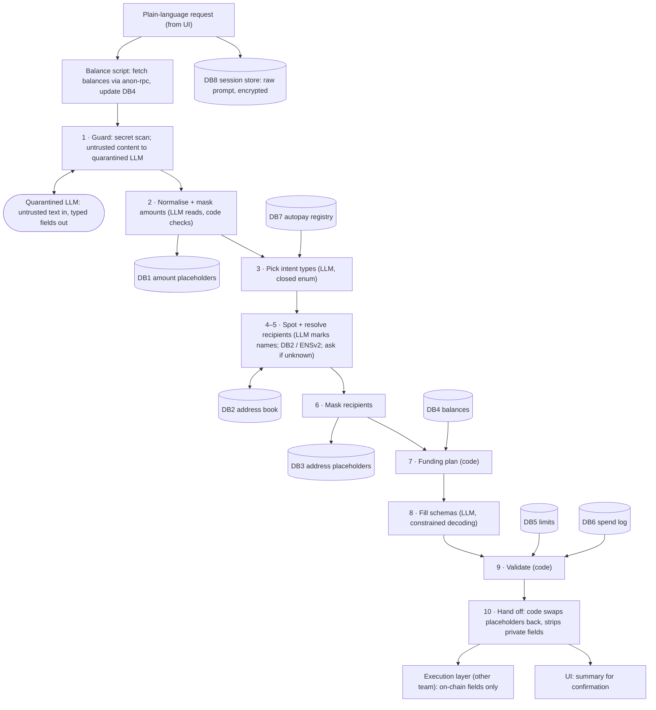
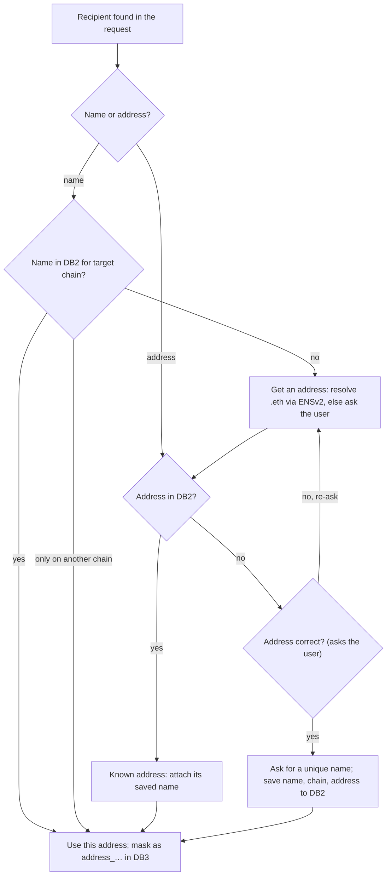

# Agent Layer — Wallet Access Layer

The agent layer takes one plain-language request from the user and hands the execution layer an ordered array of filled intents with real amounts and addresses. It never signs, bridges or schedules anything itself.

- **Input:** a plain-language prompt from the UI (plus any pasted text, attached files or shared URLs).
- **Output:** an intent envelope (`i`, `j`, `k`, `l` intents in execution order) carrying only what the chain needs, for the execution layer; plus a plain-language summary that goes to the UI only.
- **Model:** a local LLM only. After step 2 it sees placeholders, never real amounts or addresses. Code swaps real values back in at hand-off.
- **Scope:** this layer only. UI, signing, bridging, autopay contracts and CRE jobs belong to other layers.

---

## 1. Intent types

| ID | Intent | Used when |
| --- | --- | --- |
| `i` | Simple payment to an address | Pay a person an amount on one chain |
| `j` | Bridge funds from chain X to chain Y (to the user's own account) | The target chain lacks funds; one `j` per source chain |
| `k` | Autopayment | Recurring payments; the execution layer creates a delegate account from the autopay factory with a CRE job |
| `l` | Cancel autopayment | Stop an existing autopay; the prefund left over is always refunded |

Complex requests produce an ordered array, for example `[j, i]`, `[j, j, i]`, `[j, k]` or `[i, i, i]`. Bridges always come first, and every `i` or `k` lists the `j` steps it depends on.

Two request types produce no intents:

- **Balance questions** ("what's my balance?") are answered from DB4, per chain and token.
- **Anything else** (e.g. swaps) gets a reply that it isn't supported.

**v1 scope:** testnet only (Sepolia, Base Sepolia, Arbitrum Sepolia); tokens USDC and native ETH.

---

## 2. Pipeline



The model makes four judgement calls: what number each amount phrase means and whether it is paid or only context (step 2), which intent types the request needs (step 3), which names are payees and which are only mentioned (step 4), and which placeholder goes in which slot (step 8). Everything else is code. The steps run as a **fixed state machine**, not free tool choice, so the model cannot reorder steps or call `add_contact` without the user's "yes".

### Who does each step

| Step | Done by | Database | Notes |
| --- | --- | --- | --- |
| 0 Refresh balances | balance script (outside the agent) | writes DB4 | runs via anon-rpc on every prompt, before the agent receives it |
| 1 Guard | code: secret detectors; untrusted content routed to the quarantined LLM | — | keys and injected text never reach the agent LLM |
| 2 Normalise + mask amounts | LLM turns amount phrases into numbers and tags each `pay` or `context`; code checks each, then `mask_amounts`; context amounts are dropped | writes DB1 | see §3 |
| 3 Pick intent types | LLM, output limited to `i`, `j`, `k`, `l`, `balance`, `unsupported` | reads DB7 (for `l`) | |
| 4 Spot recipients | LLM marks name and group spans as `payee` or `mentioned`; addresses found by regex; mentioned names are dropped | — | see §4 |
| 5 Resolve recipients | tools `lookup_name`, `lookup_address`, `resolve_ens`, `list_subnames`, `ask_user`, `add_contact` | reads/writes DB2 | see §4 |
| 6 Mask recipients | tool `mask_recipient` | writes DB3 | |
| 7 Funding plan | tool `plan_funding` | reads DB4; writes derived amounts to DB1 | see §5 |
| 8 Fill schemas | LLM, constrained decoding: slots accept only this request's placeholders and enums | reads DB1/DB3 keys | see §6 |
| 9 Validate | code: JSON Schema, coverage, limits, totals vs balances | reads DB4, DB5, DB6 | see §8 |
| 10 Hand off | code swaps placeholders for real values and strips every field the chain doesn't need; the summary goes to the UI only | reads DB1, DB3 | see §6.3, §8.4 |

Chain and token words ("arbi", "base", "usdc") are matched by code against alias tables. The LLM only picks from the resulting enum.

### Tools

| Tool | Type | What it does |
| --- | --- | --- |
| `detect_secrets` | code | finds private keys, xprv, seed phrases (BIP-39 word runs + checksum); a hit drops the request |
| `mask_amounts` | code | verifies LLM-normalised `pay` amounts (§3), writes DB1, replaces phrases with `amount_…`; drops `context` amounts |
| `new_placeholder(kind)` | code | mints `amount_…` / `address_…` placeholders (§7.1) |
| `lookup_name(name, chain_id)` | code | DB2 lookup by name for a chain |
| `lookup_address(address)` | code | DB2 reverse lookup |
| `resolve_ens(name, chain_id)` | code | ENSv2 Universal Resolver, chain-specific address record, over anon-rpc |
| `list_subnames(parent)` | code | ENSv2 indexer/subgraph query for a parent's subnames |
| `ask_user(question, chips)` | code | clarification via the UI; max 3 re-asks per question |
| `add_contact(name, chain_id, chain, address)` | code | writes DB2; runs only after an explicit user "yes" |
| `mask_recipient(name, address)` | code | writes DB3, replaces the name with `address_…` |
| `plan_funding(payments)` | code | chain choice, shortfalls, `j` intents, derived amounts |
| `find_autopays(recipient)` | code | DB7 lookup of active autopays for `l` |
| `validate(envelope)` | code | schema + coverage + limits + balances |
| `swap_back(envelope)` | code | placeholders → real values, then strips private fields for hand-off (§6.3) |

---

## 3. Amount normalisation (step 2)

Users write amounts however they like ("fifty", "5k", "half my USDC", "$50"). The LLM, driven by a prompt builder, turns each amount phrase into a number. This is the one place the model writes a value, so code checks it before anything else happens.

1. The LLM returns a list of `{phrase, number, token, role}`, where `phrase` must be copied from the prompt and `role` is `pay` (this amount moves) or `context` (part of the story, e.g. "he charged 500 last time"). `context` amounts are dropped silently: not checked further, not written to DB1, not counted for coverage, not shown. The steps below apply to `pay` amounts.
2. Code checks that each phrase appears verbatim in the prompt. A phrase that doesn't is dropped, and the agent asks for the amount.
3. Where code can parse the phrase itself (digits, number words, `5k`), the two numbers must match exactly.
4. Relative phrases (`all`, `half`, `max`) are only marked by the LLM. Code computes them from DB4; for ETH, "all" means balance minus the gas reserve.
5. Fiat phrases count 1:1 for USDC ("$50" = 50 USDC). For ETH the agent asks for an ETH amount, because this layer has no price feed.
6. Each checked number is written to DB1, and its phrase is replaced by an `amount_` placeholder. Any number code could not verify is shown in the summary as "you wrote 'fifty bucks' → 50 USDC".

From here on, the model sees only placeholders.

If the model mis-tags a real payment as `context`, that payment is missing from the summary, and the user catches it before saying yes.

---

## 4. Recipient resolution (steps 4–6)

Every path ends at one known address. The only loop is "no, re-ask", which sends the user back to entering an address.



**Rules:**

- **Payees vs mentioned names.** At step 4 the LLM tags every name span `payee` or `mentioned`. In "Pay A 50 for the service A did for my friend X", only A is a payee. Mentioned names are dropped silently: no DB2 lookup, no ENS lookup, no placeholder, not shown, not counted for coverage. Only payees enter the flow below.
- **ENS names.** If the recipient ends in `.eth` and DB2 has no row for it on the target chain, "Get an address" resolves it through ENSv2 (Universal Resolver, the address record for that chain). The result is outside data, so it still passes "Address in DB2?" and "Address correct?". The user sees "aradhya.eth → 0x3fA9…c21E on Base Sepolia. Correct?", and on yes the row is saved with `ens_name` set. On later uses the agent re-resolves the name; if the address has changed since it was saved, it asks again before using it.
- **Address known on another chain.** If the name has a DB2 row on another chain but not the target chain, the agent reuses that address without asking. It does not write a new DB2 row, so DB2 stays user-confirmed only. The summary says "same address as on Arbitrum Sepolia". *Accepted risk:* a smart-contract wallet can have different addresses on different chains, and funds sent to the wrong one may be unrecoverable.
- **Unique names.** Every name in DB2 is unique, and every address has exactly one name, since an EVM address is the same person on every chain. At "Ask for a name", a name that is already taken is refused and the user is asked for another.
- **Clarification UI** (chips under each question):
  - *Who is "Mihr"?* → Paste an address · Pick a saved contact (closest matches)
  - *Is 0x3fA9…c21E correct?* → Yes · No, re-enter. The first and last 4 characters are shown in bold so a lookalike address is easy to spot.
  - *Save this address as?* → text field prefilled with the word from the request

### 4.1 Group sends under an ENS name

"Send 10 usdc to everyone under iitr.eth" pays every subname under that parent. The parent can be a `.eth` name or a DNS name imported into ENS (e.g. `iitr.ac.in`). The parent's ENSv2 registry defines the group, not a local contact list.

1. The LLM marks a group recipient ("everyone under", "all of", "@domain") and the parent name.
2. `list_subnames(parent)` queries an ENSv2 indexer (subgraph) for the parent's subnames. The indexer learns which parent was queried, never the payment.
3. Each subname is resolved for the target chain over anon-rpc. Subnames with no address on that chain are shown as "can't pay".
4. The user sees the member list with checkboxes and the total (amount × members), and confirms.
5. Code emits one `i` per member, all sharing one amount placeholder. `plan_funding` plans for the total.

- **No size cap:** everyone under the name is paid, and the daily limit is the only brake.
- **Over the daily limit:** the agent shows the total and today's remaining allowance and asks whether to go ahead this once. A yes applies to this request only; DB5 is unchanged.
- **Parent not in ENS:** the agent says so and asks for a `.eth` parent.
- **Members are not saved to DB2.** They're re-read from ENS on every request, because the group can change.

---

## 5. Choosing intents and funding (step 7)

| Request | Balance situation (DB4) | Intent array |
| --- | --- | --- |
| Pay A amount B | one or more chains have ≥ B and A has an address there | `[i]` on the qualifying chain with the largest balance |
| Pay A amount B | no single chain has B; all chains together do | `[j …, i]` into the chain with the largest balance |
| Pay A amount X on chain C | C has ≥ X | `[i]` on C |
| Pay A amount X on chain C | C has < X; other chains cover the shortfall | `[j …, i]`, one `j` per source chain |
| Pay A amount X weekly | C can cover the prefund (total cap) | `[k]` |
| Pay A amount X weekly | C cannot cover the prefund | `[j …, k]` |
| Several payments in one request | planned together | all `j` first, then `i`/`k` in the order the user wrote them |
| Pay everyone under an ENS name | total = amount × members | `[j …, i, i, …]` |
| Stop paying A (autopay) | an active autopay to A in DB7 | `[l]`; if several match, the user picks one |
| Any | total across allowed chains < total needed | no intents; the agent reports the shortfall per chain |

### `plan_funding` algorithm

1. Give every payment a target chain: the stated chain, else the qualifying chain with the largest balance.
2. Sum the need per chain and token across all payments in the request.
3. Shortfall = need − balance on each chain; surplus = balance − need on the others. For ETH, balance means balance minus `eth_gas_reserve`.
4. Cover each shortfall from the largest surplus first, so there are as few `j` intents as possible.
5. Each `j` amount = shortfall × (1 + `bridge_buffer_pct`), default 2%, to cover the bridge fee. The source surplus must cover the padded amount. Anything left over stays in the user's own account on the destination chain.
6. Write each bridge amount to DB1 as a new placeholder with `source = derived`.
7. Reject the plan if any chain it touches has no ETH for gas, or if more than `max_bridges_per_request` bridges are needed.
8. If any shortfall remains, stop and report it; nothing is handed off.

**Worked example.** Prompt: "Send 40 usdc to ARADHYA on base, and 20 usdc to mihir on arbitrum". Balances: 50 USDC on Arbitrum Sepolia, 30 on Base Sepolia.

```json
[
  { "intent_id": "j", "step": 0, "token": "USDC", "source_chain_id": 421614, "dest_chain_id": 84532, "amount": "amount_d41c09e2", "receiver": "self", "funds_steps": [1] },
  { "intent_id": "i", "step": 1, "depends_on": [0], "token": "USDC", "chain_id": 84532,  "amount": "amount_7f2c1a90", "recipient": "address_91ab33f0" },
  { "intent_id": "i", "step": 2, "token": "USDC", "chain_id": 421614, "amount": "amount_02bd6e15", "recipient": "address_5c7e2a41" }
]
```

DB1: `amount_d41c09e2 = 10.2` (derived: 10 shortfall + 2%), `amount_7f2c1a90 = 40`, `amount_02bd6e15 = 20`. Arbitrum keeps 50 − 20 − 10.2 = 19.8 USDC.

### Follow-ups ("send 5 more")

Session memory keeps the last 5 handed-off intent arrays for the current chat. A request may reuse the previous recipient, chain and token only when it contains a back-reference word (more, again, same, her, him, them). Code detects the word, and only then adds the previous placeholders to the schema enums.

- A new amount is always required: "send 5 more" is a new payment of 5, never the last amount + 5.
- Reused fields are marked "from your last payment" in the summary.
- Session memory is cleared when the chat closes.
- The raw prompts of the session are kept encrypted in DB8, and deleted when the chat closes. They are never logged, never sent to any other layer, and never used to build an intent after their own request.

### Confirmation and cancelling

- The agent builds the summary; the UI shows it and collects "yes". Signing approval stays with the execution layer.
- "No" discards the plan. The user rephrases from scratch. Its DB1/DB3 rows stay until the session closes (§7.3), but no later intent can use them.
- Each clarification question is re-asked at most 3 times, then the request is dropped with a short message.
- "Cancel" at any point drops the request. Its placeholders stay until the session closes (§7.3), but no later intent can use them.

---

## 6. JSON schemas

### 6.1 LLM-facing envelope (placeholders)

Before each fill, code narrows `amountRef` and `addressRef` from a pattern to an enum of the placeholders that exist in this request. It also narrows `chainId` and `token` to the values parsed from the prompt. The decoder then cannot produce any other value.

```json
{
  "$schema": "https://json-schema.org/draft/2020-12/schema",
  "$id": "agent-layer/intent-envelope/v1",
  "type": "object",
  "additionalProperties": false,
  "required": ["request_id", "intents"],
  "properties": {
    "request_id": { "type": "string", "pattern": "^req_[a-f0-9]{12}$" },
    "intents": {
      "type": "array", "minItems": 1,
      "items": { "oneOf": [
        { "$ref": "#/$defs/payment_i" },
        { "$ref": "#/$defs/bridge_j" },
        { "$ref": "#/$defs/autopay_k" },
        { "$ref": "#/$defs/cancel_l" }
      ] }
    },
    "untrusted_inputs_used": { "type": "boolean" }
  },
  "$defs": {
    "amountRef":  { "type": "string", "pattern": "^amount_[a-f0-9]{8}$" },
    "addressRef": { "type": "string", "pattern": "^address_[a-f0-9]{8}$" },
    "chainId":    { "enum": [11155111, 84532, 421614] },
    "token":      { "enum": ["USDC", "ETH"] },
    "step":       { "type": "integer", "minimum": 0 },
    "stepList":   { "type": "array", "items": { "$ref": "#/$defs/step" }, "uniqueItems": true },

    "payment_i": {
      "type": "object", "additionalProperties": false,
      "required": ["intent_id", "step", "token", "chain_id", "amount", "recipient"],
      "properties": {
        "intent_id":  { "const": "i" },
        "step":       { "$ref": "#/$defs/step" },
        "depends_on": { "$ref": "#/$defs/stepList" },
        "token":      { "$ref": "#/$defs/token" },
        "chain_id":   { "$ref": "#/$defs/chainId" },
        "amount":     { "$ref": "#/$defs/amountRef" },
        "recipient":  { "$ref": "#/$defs/addressRef" }
      }
    },

    "bridge_j": {
      "type": "object", "additionalProperties": false,
      "required": ["intent_id", "step", "token", "source_chain_id", "dest_chain_id", "amount", "receiver"],
      "properties": {
        "intent_id":       { "const": "j" },
        "step":            { "$ref": "#/$defs/step" },
        "token":           { "$ref": "#/$defs/token" },
        "source_chain_id": { "$ref": "#/$defs/chainId" },
        "dest_chain_id":   { "$ref": "#/$defs/chainId" },
        "amount":          { "$ref": "#/$defs/amountRef" },
        "receiver":        { "const": "self" },
        "funds_steps":     { "$ref": "#/$defs/stepList" }
      }
    },

    "autopay_k": {
      "type": "object", "additionalProperties": false,
      "required": ["intent_id", "step", "token", "chain_id", "recipient", "amount_per_payment", "schedule", "limits", "cre_job"],
      "properties": {
        "intent_id":          { "const": "k" },
        "step":               { "$ref": "#/$defs/step" },
        "depends_on":         { "$ref": "#/$defs/stepList" },
        "token":              { "$ref": "#/$defs/token" },
        "chain_id":           { "$ref": "#/$defs/chainId" },
        "recipient":          { "$ref": "#/$defs/addressRef" },
        "amount_per_payment": { "$ref": "#/$defs/amountRef" },
        "schedule": {
          "type": "object", "additionalProperties": false,
          "required": ["frequency", "interval", "timezone", "start_date", "end"],
          "properties": {
            "frequency":    { "enum": ["daily", "weekly", "monthly"] },
            "interval":     { "type": "integer", "minimum": 1, "maximum": 12 },
            "days_of_week": { "type": "array", "minItems": 1, "uniqueItems": true,
                              "items": { "enum": ["MON", "TUE", "WED", "THU", "FRI", "SAT", "SUN"] } },
            "day_of_month": { "type": "integer", "minimum": 1, "maximum": 28 },
            "time_of_day":  { "type": "string", "pattern": "^([01][0-9]|2[0-3]):[0-5][0-9]$" },
            "timezone":     { "type": "string" },
            "start_date":   { "type": "string", "format": "date" },
            "end": { "oneOf": [
              { "type": "object", "additionalProperties": false, "required": ["type", "count"],
                "properties": { "type": { "const": "after_count" }, "count": { "type": "integer", "minimum": 1, "maximum": 520 } } },
              { "type": "object", "additionalProperties": false, "required": ["type", "date"],
                "properties": { "type": { "const": "on_date" }, "date": { "type": "string", "format": "date" } } },
              { "type": "object", "additionalProperties": false, "required": ["type"],
                "properties": { "type": { "const": "until_cancelled" } } }
            ] }
          }
        },
        "limits": {
          "type": "object", "additionalProperties": false,
          "required": ["per_period_cap", "total_cap", "expires_at"],
          "properties": {
            "per_period_cap": { "$ref": "#/$defs/amountRef" },
            "total_cap":      { "$ref": "#/$defs/amountRef" },
            "expires_at":     { "type": "string", "format": "date-time" }
          }
        },
        "cre_job": {
          "type": "object", "additionalProperties": false,
          "required": ["trigger", "cron", "timezone"],
          "properties": {
            "trigger":  { "const": "cron" },
            "cron":     { "type": "string" },
            "timezone": { "type": "string" }
          }
        }
      }
    },

    "cancel_l": {
      "type": "object", "additionalProperties": false,
      "required": ["intent_id", "step", "autopay_id", "chain_id", "delegate_address", "recipient", "refund_remaining"],
      "properties": {
        "intent_id":        { "const": "l" },
        "step":             { "$ref": "#/$defs/step" },
        "autopay_id":       { "type": "string", "pattern": "^ap_[a-f0-9]{12}$" },
        "chain_id":         { "$ref": "#/$defs/chainId" },
        "delegate_address": { "type": "string", "pattern": "^0x[0-9a-fA-F]{40}$" },
        "recipient":        { "$ref": "#/$defs/addressRef" },
        "refund_remaining": { "const": true }
      }
    }
  }
}
```

### 6.2 Who fills which field

| Field | Filled by |
| --- | --- |
| `intent_id`, `step`, `depends_on`, `funds_steps` | `plan_funding` (code) |
| `amount`, `recipient`, `amount_per_payment` | LLM, choosing from this request's placeholders |
| `chain_id`, `source_chain_id`, `dest_chain_id` | stated chain: LLM picks from the parsed chain enum; otherwise `plan_funding` |
| `token` | LLM picks from the parsed token enum |
| `frequency`, `days_of_week`, `interval` | LLM picks enums after a date parser (e.g. chrono) finds the day and time words. Several payments a week with no days named are spread evenly (2 → MON, THU; 3 → MON, WED, FRI); named days are used as given |
| `start_date`, `time_of_day`, `timezone` | date parser + the user's timezone. If missing: day = today's weekday, time = 10:00, start = next occurrence |
| `schedule.end` | always asked if not stated: after N payments, on a date, or until cancelled |
| `limits.per_period_cap`, `limits.total_cap` | code: amount × payments per period / in total (until cancelled: up to `autopay_max_weeks`), written to DB1 as derived; must stay within `autopay_max_per_period` |
| `limits.expires_at` | code: end date, or start + `autopay_max_weeks` |
| `cre_job.cron` | code, built from the schedule |
| `autopay_id`, `chain_id`, `delegate_address` (for `l`) | code, from DB7 via `find_autopays` after the user picks which autopay; the LLM only marks the recipient |
| summary (not part of the envelope) | code template from real values (names, amounts, chains); sent to the UI only, never to the execution layer |

Checks the schema can't express, enforced in code:

- `source_chain_id ≠ dest_chain_id`.
- Every `depends_on` and `funds_steps` entry points to an earlier step.
- Every DB1/DB3 placeholder for this request is used exactly once (a shared group amount is allowed).
- An `until_cancelled` autopay still gets an `expires_at`.

### 6.3 Hand-off form (real values)

At step 10, code replaces every placeholder from DB1 and DB3, then strips every field the chain doesn't need. The result is validated against the hand-off schema: the envelope above with three changes.

1. `amountRef` becomes the real amount:

```json
"amountRef": {
  "type": "object", "additionalProperties": false,
  "required": ["value", "base_units", "decimals"],
  "properties": {
    "value":      { "type": "string", "pattern": "^[0-9]+(\\.[0-9]+)?$" },
    "base_units": { "type": "string", "pattern": "^[0-9]+$" },
    "decimals":   { "enum": [6, 18] }
  }
}
```

2. `addressRef` becomes a bare checksummed address, with no name and no ENS name:

```json
"addressRef": { "type": "string", "pattern": "^0x[0-9a-fA-F]{40}$" }
```

3. `untrusted_inputs_used` is removed. The execution layer gets only `request_id` and `intents`.

- `base_units` is computed from the token's decimals (USDC 6, ETH 18) with decimal-string arithmetic, never floats.
- Addresses are checked against their EIP-55 checksum before hand-off.
- The swap is a plain lookup in code; the LLM never sees this form.
- The summary, contact names and ENS names go to the UI only (§8.4).
- DB1 and DB3 rows are kept until the session closes, so follow-ups can still resolve them (§7.3).

---

## 7. Databases

All eight are local and encrypted (SQLite + SQLCipher).

| DB | Columns | Written by | Read by |
| --- | --- | --- | --- |
| **DB1** amount placeholders | placeholder (`amount_` + 8 hex), amount, token, request_id, source (`user`, `derived`, `untrusted`), created_at | `mask_amounts`, `plan_funding`, autopay caps | fill (keys only), validate, `swap_back` |
| **DB2** address book | name, chain_id, chain, address, ens_name, added_at, added_by (`user_confirmed`) | `add_contact`, only after a user "yes" (ENS results included) | `lookup_name`, `lookup_address` |
| **DB3** address placeholders | placeholder (`address_` + 8 hex), name, address, chain_id, request_id, source | `mask_recipient` | fill (keys only), validate, `swap_back` |
| **DB4** balances | chain, chain_id, token (one row per chain and token), balance, updated_at | balance script on every prompt (via anon-rpc) | `plan_funding`, validate, balance questions |
| **DB5** agent limits | see defaults below | the user, from settings only; the chat can never write here | validate, `plan_funding` |
| **DB6** spend log | tx_hash, chain_id, token, amount, recipient address, intent_id, executed_at | the execution layer reports each executed tx back | validate (sums today's spend per token) |
| **DB7** autopay registry | autopay_id, recipient name, address, chain_id, token, amount_per_payment, schedule, delegate_address, cre_job_id, status (active, cancelled, ended), created_at | the execution layer reports each autopay it creates or cancels | `find_autopays` |
| **DB8** session store | session_id, raw prompts (encrypted), last 5 handed-off intent arrays (placeholders only), created_at; deleted when the chat closes | the agent, per request | follow-ups (§5) |

**DB5 defaults**

| Setting | Default |
| --- | --- |
| `per_tx_max` | 100 USDC / 0.05 ETH |
| `daily_max` | 300 USDC / 0.15 ETH |
| `autopay_max_per_period` | equal to `per_tx_max` |
| `autopay_max_weeks` | 52 |
| `max_bridges_per_request` | 3 |
| `allowed_chain_ids` | Sepolia, Base Sepolia, Arbitrum Sepolia |
| `eth_gas_reserve` | 0.002 ETH on L2 testnets, 0.01 ETH on Sepolia |
| `bridge_buffer_pct` | 2% |

### 7.1 Placeholder generation

`new_placeholder(kind)` mints every `amount_…` and `address_…` placeholder:

1. **Random source:** 4 bytes from a cryptographically secure generator, written as 8 lowercase hex characters: `secrets.token_hex(4)` in Python, `crypto.randomBytes(4).toString('hex')` in Node. Result: `amount_7f2c1a90`, `address_91ab33f0`.
2. **Uniqueness:** the placeholder column in DB1 and DB3 is `UNIQUE`. If the insert fails on a collision, code draws a new suffix and retries.
3. **Never derived from the value.** No hashing of amounts or addresses: `hash("50")` would give the same placeholder every time 50 appears and could be brute-forced back to 50.
4. **One placeholder per phrase, per request.** "10 to A and 10 to B" gets two amount placeholders, so the coverage check can tell the payments apart. The one exception is a group send, where all members share one amount placeholder.
5. **Never reused across requests.** Follow-ups refer to earlier placeholders through session memory (DB8); nothing new is minted for them.
6. **Not counters.** Random suffixes don't reveal how many payments a user makes.

`request_id` (`req_` + 12 hex) and `autopay_id` (`ap_` + 12 hex) are minted the same way, with 6 random bytes.

### 7.2 Key rules

- DB2 key is (name, chain_id): one person can have a row per chain. Names are unique per person, and an address has exactly one name. Addresses are stored EIP-55 checksummed and checked on insert.
- DB1 and DB3 rows are scoped to one `request_id`.

### 7.3 Session clearing

DB1, DB3 and DB8 are session-scoped. They are cleared together when the session (chat) is closed, and never while it is open.

- **Trigger:** chat close only. There is no idle timeout.
- **What is cleared:** every row in DB1, DB3 and DB8, not just the current session's. If a session ever ends without a clean close (e.g. a crash), its rows are wiped at the next session close.
- **Cancelled requests:** rows from a request the user said "no" to or cancelled stay until the session closes. Only follow-ups can reference earlier placeholders, and they never reference a cancelled request.
- **Wipe:** SQLCipher `PRAGMA secure_delete = ON` for these stores, and `VACUUM` after each clear, so deleted values don't linger in free pages on disk.
- **Nothing in flight depends on them:** after hand-off the execution layer holds the real values, and autopay details live in DB7, so clearing is safe mid-bridge or after an autopay is created.
- **Persistent stores** (DB2, DB4, DB5, DB6, DB7) are not affected.

---

## 8. Guardrails

### 8.1 Prompt injection: Dual LLM

The agent LLM holds tools (`ask_user`, `add_contact`), so a quarantined LLM alone is not enough. What matters is that the tool-holding model never reads untrusted text.

| Model | Sees | Can do | Output |
| --- | --- | --- | --- |
| Agent LLM (privileged) | the user's own words (masked after step 2) | steps 2, 3, 4, 8 of the fixed state machine | numbers (checked by code), enums, placeholders |
| Quarantined LLM | pasted text in the prompt, attached files, web pages from shared URLs, recipients' ENS text records | nothing: no tools, no memory, no network | typed fields only (address matching the regex, decimal amount) or null |

- Values from the quarantined LLM go into DB1/DB3 tagged `source = untrusted`, and each needs a separate explicit confirmation from the user.
- An untrusted value can never fill an autopay (`k`), because a `k` keeps paying after the user stops watching.
- The envelope sets `untrusted_inputs_used: true` when any such value is present.

### 8.2 Other guardrails

- **Secret guard** before step 2: private keys, xprv, seed phrases (BIP-39 word runs + checksum). A hit drops the request and logs nothing.
- **Constrained decoding** at steps 3 and 8: per-request enums, so no invented amount, address, chain or intent type.
- **Amount verification** at step 2: every number must trace back to a verbatim phrase in the prompt (§3).
- **Coverage check:** every `pay` amount and every `payee` the user typed is used exactly once. A dropped or doubled payment fails validation. `context` amounts and `mentioned` names don't count.
- **Fixed state machine:** the model cannot reorder steps or call `add_contact` without the user's "yes".

### 8.3 User limits (DB5, checked at step 9)

- Per-tx max, daily max (today's spend summed from DB6), autopay max per period and max duration, max bridges per request, allowed chains.
- **Autopays** count each payment when it runs, logged in DB6. The prefund is checked against the autopay caps only.
- **Bridges** to the user's own account count only their 2% buffer as spend.
- **A breach** returns a plain message.
- **One exception:** an ENS group send over the daily limit asks the user to allow it this once. DB5 is not changed.

### 8.4 What can reach the chain

Only what a transaction needs leaves the agent layer toward the chain. Everything else the user said stays local.

| Data | Where it goes | Never goes to |
| --- | --- | --- |
| Token, chain IDs, real amounts, recipient addresses, schedule, caps, cron | execution layer (hand-off envelope) and then on-chain | — |
| Story context ("for the service A did for my friend X"), `context` amounts, `mentioned` names | dropped at steps 2 and 4 | any DB, any model output, any other layer |
| Contact names, ENS names, the summary | UI only | execution layer, calldata, memos, tx metadata |
| Raw prompt | DB8, encrypted, deleted when the chat closes | logs, any other layer |
| Placeholders, DB1–DB8 contents | this layer only | any other layer (the execution layer writes to DB6/DB7, never reads) |

How this is enforced:

1. At step 8 the model can only write enums and placeholders, so no free text can enter an intent.
2. Every schema sets `additionalProperties: false`, so no extra field survives validation.
3. `swap_back` builds the hand-off envelope from an allowlist of fields; the hand-off schema has no field for a name, an ENS name or text.
4. Interface rule for the execution layer: build calldata only from envelope fields; send native ETH transfers with empty `data`; attach no memos.

Some data becomes public on-chain whatever this layer does: sender, recipient, amount, token, chain and time of every transfer; bridge source and destination; the recipient, amount and schedule of an autopay.

---

## 9. Design decisions

| # | Topic | Decision |
| --- | --- | --- |
| 1 | Hand-off form | Real values, on-chain fields only; code (not the LLM) swaps placeholders back at step 10 |
| 2 | ENSv2 | `name.eth` resolved via ENSv2; confirmed per-chain rows saved in DB2 (`ens_name`) |
| 3 | Tokens | USDC and native ETH |
| 4 | Autopay funding | Prefund the delegate up to the total cap; `[j …, k]` allowed |
| 5 | Chain choice (no chain stated) | Largest balance among chains where the recipient has an address and balance ≥ amount |
| 6 | Recipient known on another chain | Reuse silently; summary notes it; smart-wallet risk accepted |
| 7 | Allowed chains | `allowed_chain_ids` in DB5 |
| 8 | Bridge fees | Agent pads each `j` by `bridge_buffer_pct`; leftovers stay with the user |
| 9 | Balance freshness | Balance script refreshes DB4 via anon-rpc on every prompt |
| 10 | Spend log | DB6 in the agent layer, fed by the execution layer |
| 11 | Name collisions | Names unique; one name per address |
| 12 | Final confirmation | Agent builds the summary and sends it to the UI only; UI collects "yes"; execution layer handles signing |
| 13 | Follow-ups and group sends | Follow-ups via session memory; group sends = everyone under an ENS parent name |
| 14 | Autopay cancellation | Intent `l`, backed by DB7; editing = cancel + new `k` |
| 15 | Model | Local only; a frontier fallback can be added later on masked text |
| 16 | ETH gas | Per-chain `eth_gas_reserve`; "all my ETH" = balance − reserve |
| 17 | ETH bridge route | Execution team's call; `j` shape unchanged |
| 18 | Network | Testnet only for v1 |
| 19 | Autopay vs daily limit | Each payment counts when it runs |
| 20 | Bridges vs limits | Only the buffer counts |
| 21 | Group send over limit | Ask to allow this once; DB5 unchanged |
| 22 | Subname source | ENSv2 indexer/subgraph; addresses via anon-rpc; non-ENS parent → ask for a `.eth` parent |
| 23 | Untrusted inputs | Pasted text, files, web pages, ENS text records → quarantined LLM only |
| 24 | Multi-day autopays | Spread evenly unless days are named |
| 25 | "No", re-asks, "cancel" | "No" discards; max 3 re-asks; "cancel" drops the request |
| 26 | `autopay_max_per_period` default | Equal to `per_tx_max` |
| 27 | Placeholder generation | 8 hex from a secure random source; `UNIQUE` column + retry; never derived from the value |
| 28 | Private fields at hand-off | Stripped: the execution layer gets on-chain fields only; summary and names go to the UI |
| 29 | Story context | `context` amounts and `mentioned` names tagged at steps 2 and 4, then dropped silently |
| 30 | Raw prompt | Kept encrypted in DB8 for the session; deleted when the chat closes |
| 31 | Placeholder lifetime | DB1, DB3 and DB8 cleared together on chat close only; no idle timeout; cancelled requests' rows kept until then; wiped with `secure_delete` + `VACUUM` |

---

## 10. Interfaces with other layers

| Direction | What | Format |
| --- | --- | --- |
| UI → agent | prompt, attachments, shared URLs, clarification answers, final "yes" / "no" | text + files |
| Agent → UI | clarification questions with chips, summary (with names and amounts), balance answers, error messages | text + chip options |
| Balance script → DB4 | per-chain, per-token balances, refreshed on every prompt | DB rows |
| Agent → execution layer | intent envelope, hand-off form (§6.3): `request_id` + `intents`, on-chain fields only. Calldata is built only from these fields; ETH transfers carry empty `data`; no memos (§8.4) | JSON |
| Execution layer → DB6 | each executed tx | DB rows |
| Execution layer → DB7 | each autopay created or cancelled | DB rows |
| Agent → ENSv2 | Universal Resolver lookups (over anon-rpc); subname queries (indexer) | RPC / GraphQL |
