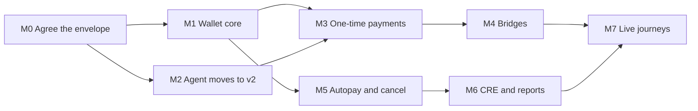

# Implementation plan

Date: 6 November 2026. Status: first draft. Progress goes in [IMPL_TRACKER.md](IMPL_TRACKER.md).

This file sets the **order of work**. The details of each task stay in Parts 0–11, listed in [README.md](README.md). The design
changes this plan builds on are in [ARCHITECTURE_CHANGES.md](ARCHITECTURE_CHANGES.md).

## What done means

These journeys work on the three testnets, from a typed request to a confirmed onchain effect:

| # | Journey | Intents | Works after |
| --- | --- | --- | --- |
| 1 | Send 10 USDC to Alex | `i` | M3 |
| 2 | Send 10 USDC to Alex on Arbitrum | `i` | M3 |
| 3 | Send 10 to Alex and 20 to Bob, in one batch | `i` | M3 |
| 4 | One-time payroll to ENSv2 names, with each person's own amount | `i` | M3 + R-2 |
| 5 | Any of these when funds are on another chain | `j` + `i` | M4 |
| 6 | Weekly autopay to one person | `k` | M6 |
| 7 | Recurring payroll, up to 50 people | `k` | M6 + R-2 |
| 8 | Cancel any autopay | `l` | M5 for the plan, M6 for confirming no later run pays |

Monthly schedules are not part of this plan.

## Where things stand

- **Done:** envelope schema, mapping and the two-stage check (Part 1). 137 wallet tests pass.
- **Not started:** everything that signs or sends. No wallet code has moved money yet.
- **Agent:** complete for v1, but still sending envelope v1, which the wallet rejects.

## Order of work

M1 and M2 can run at the same time. So can M4 and M5.

### M0: agree the envelope

| Task | Done when |
| --- | --- |
| Name the agent owner (OQ-05) | Someone owns Part D of `ARCHITECTURE_CHANGES.md` |
| Confirm changes C-1 to C-5, R-1 and R-2 | Recorded in the tracker |
| Settle where the schemas live (OQ-06) | One copy, or a test that keeps two copies equal |
| Commit the work on this branch | `wallet` is pushed and reviewable |

### M1: wallet core, on a local chain (Parts 2, 3)

**Needs:** OQ-02, OQ-04, OQ-08, OQ-15, OQ-19.

| Task | Part |
| --- | --- |
| `POST /v1/intents` calling `checkEnvelope`, returning 2xx or 4xx | 2 |
| Durable store, so a repeated `Idempotency-Key` returns the first result after a restart | 2 |
| Step runner: step order, `depends_on`, failure handling | 2 |
| `intent_result` reports to the agent | 2 |
| Encrypted key on the device, approval per payment, signing (OQ-01) | 3 |
| 7702 upgrade per chain | 3 |

**Exit:** a test envelope goes through the service to a signed 7702 transaction on a local chain. Killing the process at each crash
point in Part 2 never pays twice.

### M2: agent moves to v2 ([AGENT_HANDOFF.md](AGENT_HANDOFF.md))

**Needs:** an owner.

Phase 1 doesn't depend on any payroll decision. Phase 2 can follow later.

**Exit:** the agent's acceptance tests pass on v2, and every envelope they produce passes the wallet's `checkEnvelope`.

### M3: one-time payments (Part 4)

| Task | Done when |
| --- | --- |
| Build and send the `i` batch, ETH and USDC | Local chain tests pass |
| Check the effect by balance change, not the receipt (A.5 rule 5) | A reverted or empty payment reports `failed` |
| Run a 100-recipient batch | Gas matches B12 within reason |
| Connect agent to wallet, local chain | Journeys 1–3 pass end to end |

Journey 4 also needs R-2 and a live ENSv2 check. ENSv2 is on the not-yet-tested list (A.6), and the resolver and indexer settings in
`config.example.json` are still placeholders.

### M4: bridges (Part 5)

**Needs:** a funded testnet wallet (W0-06), one real CCIP send (W0-07), then OQ-07.

The real send comes first, because forks can't show that USDC arrives on these lanes (F-7, F-8). It sets `bridge_buffer_pct`, the
arrival wait and the detection method. Then build the `[approve, ccipSend]` batch with the exact quoted fee.

**Exit:** journey 5 passes on testnets, including a dependent step that waits for arrival.

### M5: autopay and cancel, on a local chain (Parts 6, 7, 8)

**Needs:** OQ-09, OQ-10, OQ-11, OQ-17, OQ-20.

| Task | Part |
| --- | --- |
| **First:** run 50 recipients through `register` and a report on `IntentExecutorV3`; measure gas and report size | 6 |
| Close the executor's test gaps | 6 |
| Delegation, three caveats, `register`, `plan_id` report, with a list of recipients | 7 |
| Read the delegation from `Registered`, then the `[cancel, disableDelegation]` batch | 8 |

If the 50-recipient test fails, lower `MAX_RECIPIENTS_AUTOMATED` and the schema's `maxItems` to what works, before building further.

**Exit:** on a local chain, a list autopay pays on schedule, refuses early and repeat runs, and stops after cancel.

### M6: CRE and reports (Parts 9, 10)

**Needs:** CRE access (W0-05, OQ-16), OQ-14, OQ-18. If access is still blocked, build against the simulator and leave the real
forwarder check for M7.

**Exit:** the cron pays due plans, skips cancelled ones, and each run produces one `autopay_payment` report with no double counting.

### M7: live journeys (Part 11)

**Needs:** the executor deployed on three testnets (OQ-17).

**Exit:** every journey in the table above passes on testnets, every A.6 item is closed, and the failure drills in Part 11 pass.

## Decisions needed

Ordered by what they block first. The recommendations come from [OPEN_QUESTIONS.md](OPEN_QUESTIONS.md) and are not decisions.

| Question | Recommendation | Blocks |
| --- | --- | --- |
| OQ-05: who moves the agent to v2? | Name one owner | M2 |
| OQ-06: where do the schemas live? | One shared package | M0, M2 |
| OQ-02: how does the user approve, and who builds it? | Needs the UI team's input | M1 |
| OQ-04: what store does the wallet use? | Encrypted SQLite, with the agent's logging allowlist | M1 |
| OQ-08: what happens to other steps when one fails? | Run independent steps; report never-started dependents as `failed` | M1 |
| OQ-19: when does the 7702 upgrade happen? | First use per chain; refuse other delegations | M1 |
| OQ-20: how is the fee set for a list autopay? | Base fee plus an amount per recipient | M5 |
| OQ-21: where does the payroll list come from? | Pasted or uploaded list, confirmed row by row | Journeys 4 and 7 |

## Actions only you can take

| Action | Why it matters |
| --- | --- |
| Request CRE deploy access: `cre account access` | M6 and M7 |
| Fund one testnet wallet with ETH and USDC on all three chains | M4 and M7 |
| Decide whether `docs/spec/` stays in the repo | The tracker notes these files were meant to stay out, but the plan cites them throughout |

## Risks

| Risk | Effect | What we do |
| --- | --- | --- |
| USDC over live lanes is burn and mint through CCTP, and is unproven (F-7, F-8) | Bridges may arrive late or behave differently | The real send comes before any bridge code |
| 50 recipients haven't run through `IntentExecutorV3` | Recurring payroll may have a lower limit | First task in M5 |
| CRE access stays blocked | No live autopay | Simulator in M6; live check stays open |
| Agent has no owner | Nothing works end to end | Wallet tests use fixtures; M3's end-to-end task waits |
| Recurring payroll publishes pay amounts onchain | Could be unacceptable for real payroll | Called out in C-1; needs a product decision before journey 7 ships |
| The ENSv2 resolver and subname indexer are unproven live | Journey 4 fails on real names | Test early against Sepolia in M3 |

## Next steps

1. Review `ARCHITECTURE_CHANGES.md`, then confirm or change C-1 to C-5, R-1 and R-2.
2. Commit this branch.
3. Name the agent owner.
4. Answer OQ-02, OQ-04, OQ-08 and OQ-19.
5. Start M1 with `POST /v1/intents` and the durable store.
