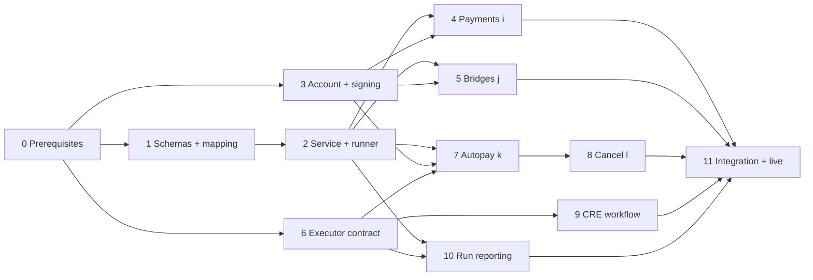

# Wallet implementation plan

Date: 6 November 2026. Spec: `docs/spec/AGENT_SPEC_v1.1.md` (v1.1), mainly §12.5, §14.2, §14.3 and Appendix A (§25).

Progress, decisions and findings are recorded in [IMPL_TRACKER.md](IMPL_TRACKER.md). The order of work is in
[IMPLEMENTATION_PLAN.md](IMPLEMENTATION_PLAN.md). Changes from the agent design are in
[ARCHITECTURE_CHANGES.md](ARCHITECTURE_CHANGES.md).

This plan covers what the README calls the **execution layer**: the 7702 account, signing, one-time payments, bridges,
autopays, cancels, the executor contract, the CRE workflow and the reports back to the agent.

## How this plan treats sources

Where sources disagree, the higher one wins. This follows README §0.

| Rank | Source | Used for |
| --- | --- | --- |
| 0 | [ARCHITECTURE_CHANGES.md](ARCHITECTURE_CHANGES.md) | Changes to the spec, for what it covers |
| 1 | `docs/spec/AGENT_SPEC_v1.1.md` | What must be built |
| 2 | `docs/spec/DECISIONS.md`, `docs/spec/TEST_MAP.md`, `docs/spec/TESTED.md` | Why, and how far each thing is proven |
| 3 | Code in `~/zkApi` (`final/code/`, `final/flex/lab.zip`, `work2/`, `ccipfork/`) | What already exists and how the tests really did it |

Every task names its source. Three labels are used throughout:

- **Spec:** the README says this directly.
- **Tested code:** the README is silent or brief, and this is what the tested code does.
- **Needs decision (OQ-nn):** nothing settles it. It is listed in [OPEN_QUESTIONS.md](OPEN_QUESTIONS.md) and **not**
  assumed in this plan. A recommendation there is only a recommendation.

Test results are quoted from `docs/spec/TESTED.md` and `docs/spec/TEST_MAP.md`. They were not re-run while writing this plan.

## What exists today

| Item | State | Location |
| --- | --- | --- |
| Verified schemas (`intent.v2.ts`, `bridge.v2.ts`) | Exists; 43/43 and 18/18 cases | `lab.zip`, `src/` |
| Redeem encoder (`redeem.v2.ts`) | Exists; used by the e2e and V suites | `lab.zip`, `src/` |
| `IntentExecutorV3.sol` | Exists; 16/16 on a local chain; **not deployed anywhere** | `final/code/`, `lab.zip` |
| Envelope → plan translator | **Test code only**, inside `flex.handoff.test.ts` | `final/flex/` |
| Execution service (`POST /v1/intents`) | **Does not exist** | Only mentioned in the README |
| Key handling and signing | **Does not exist.** Tests pass raw private keys | `lab.zip`, `src/chain.ts` |
| CRE workflow for V3 (cron + `filterLogs`) | **Does not exist.** The only workflow targets the old executor | `work2/cre-intents/intake/` |
| Autopay run reporting (`autopay_payment`, `autopay_status`) | **Does not exist** | — |

## Three things to know first

1. **The agent layer in this repo implements README v1, not v1.1.** It emits envelope `version: "1"` with `prefund`,
   `cre_job` and `delegate_address`, and the wallet must reject those. Wallet code can be built and tested against §12.5
   alone, but agent and wallet cannot run together until this is fixed. See
   [Part 0](00-prerequisites.md) and OQ-05.
2. **The signer is decided: the wallet holds the key (OQ-01).** The README never covered it. The approval surface and key
   creation or import are still open (OQ-02).
3. **CRE deploy access was not enabled** at the last check (`RESULTS.md`, 5 Nov). Without it, the real KeystoneForwarder
   path and the `filterLogs` workflow stay untested, and `setExpectedWorkflowId` has no real workflow id to use.

## Parts

| Part | Document | Delivers | Needs |
| --- | --- | --- | --- |
| 0 | [Prerequisites and gates](00-prerequisites.md) | Decisions, access, pending live checks, agent v1.1 hand-over | — |
| 1 | [Schemas and mapping](01-schemas-and-mapping.md) | Verified schemas in the project, real translator | OQ-03, OQ-06 |
| 2 | [Service and step runner](02-service-and-runner.md) | `/v1/intents`, idempotency, step order, `intent_result` reports | 1; OQ-04, OQ-08 |
| 3 | [Account and signing](03-account-and-signing.md) | Signer, 7702 upgrade per chain | OQ-01, OQ-02, OQ-19 |
| 4 | [One-time payments `i`](04-payments-i.md) | Single and group payments | 2, 3 |
| 5 | [Bridges `j`](05-bridges-j.md) | CCIP send, fee rules, arrival wait | 2, 3; OQ-07 |
| 6 | [Executor contract](06-executor-contract.md) | V3 deployed on three testnets | OQ-16, OQ-17 |
| 7 | [Autopay creation `k`](07-autopay-k.md) | Delegation, `register()`, `plan_id` report | 2, 3, 6; OQ-09, OQ-10, OQ-11 |
| 8 | [Cancel `l`](08-cancel-l.md) | One cancel batch | 2, 3, 7 |
| 9 | [CRE workflow](09-cre-workflow.md) | Cron, event reading, simulation, reports | 6; OQ-16, OQ-18 |
| 10 | [Autopay run reporting](10-run-reporting.md) | `autopay_payment`, `autopay_status` | 2, 6; OQ-14 |
| 11 | [Integration and live verification](11-integration-and-live.md) | Agent ↔ wallet end to end, every A.6 item closed | All; agent v1.1 |

Parts 4 and 5 can run in parallel, as can 6, 9 and 10 once their inputs exist. Part 7 is the first part that needs a
deployed or local executor.

## Traceability: every wallet requirement to a part

### §14.2 execution contract

| Rule | Requirement | Part |
| --- | --- | --- |
| Response codes | 2xx accepted; 4xx `{message}`; 5xx or timeout means retry | 2 |
| 1 | Calldata only from envelope fields; ETH with empty `data`; no memos | 1, 4, 5, 7 |
| 2 | Step order; wait for every `depends_on` | 2 |
| 3 | `i`: one transaction, batch, all or none | 4 |
| 4 | `j`: one batch, fee quoted, capped and exact, wait for arrival | 5 |
| 5 | `k`: batch, delegation, three caveats, salt, `register`, report `plan_id` and executor | 7 |
| 6 | `l`: `[cancel, disableDelegation]`, no refund | 8 |
| 7 | Repeated `Idempotency-Key` returns the original result, executes nothing twice | 2 |
| 8 | Report every outcome; success means the effect, not the receipt | 2, 4, 5, 7, 8, 10 |

### §14.3 reports

| Kind | Part |
| --- | --- |
| `intent_result` | 2 (client), with the effect check from 4, 5, 7, 8 |
| `autopay_payment` | 10 |
| `autopay_status` | 10 |

### §12.5 mapping table

| Row | Part |
| --- | --- |
| `i`, `k`, `j`, `l`, `token`/`token_address`, `step`/`depends_on`/`funds_steps` | 1 |
| `l`: read the signed delegation from `Registered` and hash it | 1 (shape), 8 (read) |

### Appendix A

| Item | Part |
| --- | --- |
| A.1 user account, DelegationManager, DeleGator addresses | 3 |
| A.1 executor, `setExpectedWorkflowId` | 6 |
| A.1 CRE: one workflow, cron only | 9 |
| A.2 all schema rules | 1 |
| A.3 `i` | 4 |
| A.3 `k` steps 1–3 | 7 |
| A.3 `k` step 4 (cron) | 9 |
| A.3 `k` step 5 (executor checks) | 6 |
| A.3 `l` | 8 |
| A.3 `j`, A.4 registry | 5 |
| A.5 rule 1 (USDC is `transfer`) | 1, 4, 7 |
| A.5 rule 2 (`startAt` as caveat) | 7 |
| A.5 rule 3 (always batch) | 4, 7 |
| A.5 rule 4 (expected workflow id) | 6 |
| A.5 rule 5 (effect, not receipt) | 2, 10 |
| A.5 rules 6, 7, 8 (exact fee, exact approve, receiver is user) | 5 |
| A.5 rule 9 (nonces, `maxFeePerGas` in simulation) | 9 |
| A.5 rule 10 (15 HTTP calls per run) | 9 |
| A.5 CRE limits (report 50 KB, 10 M gas, cron ≥ 30 s, 3 workflows) | 9 |
| A.6 every row | 0 (fork run), 11 (the rest) |

### Agent acceptance tests that need the wallet to be real

A-02, A-03, A-04, A-08, A-11, A-51, A-52, A-54, A-55 and A-64 are agent tests with a fake execution layer today. Part 11
runs the money-moving ones against the real wallet.

## Not in this plan

The README or `docs/spec/DECISIONS.md` lists these as out of scope or still open:

- Simulating a hand-off at the agent's summary stage (`/v1/simulate`). `docs/spec/DECISIONS.md` "Still open" 1. The wallet does simulate before every signature; see R-3 in [ARCHITECTURE_CHANGES.md](ARCHITECTURE_CHANGES.md).
- Opening the executor to any keeper; session keys; monthly schedules; group autopays; moving ETH between chains.
- Swaps, mainnet, tokens other than USDC and ETH (§1.5).
- Wallet UI design. The README defines only UI ↔ agent (§14.1). See OQ-02.

Changes to the agent layer are also outside this plan. Part 0 lists them only as a dependency.
